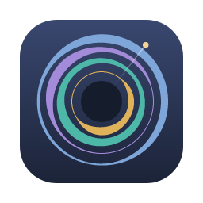
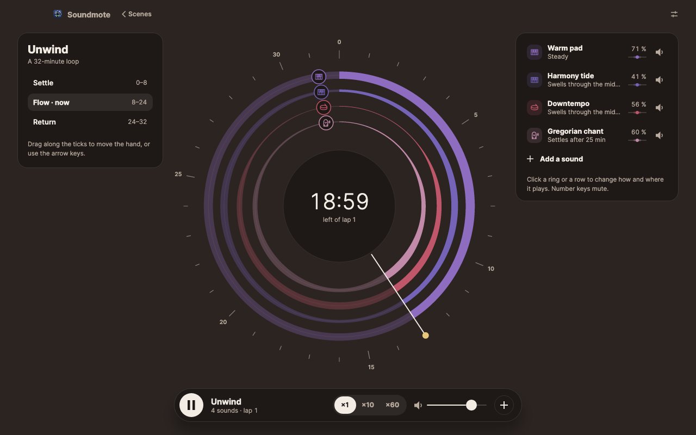
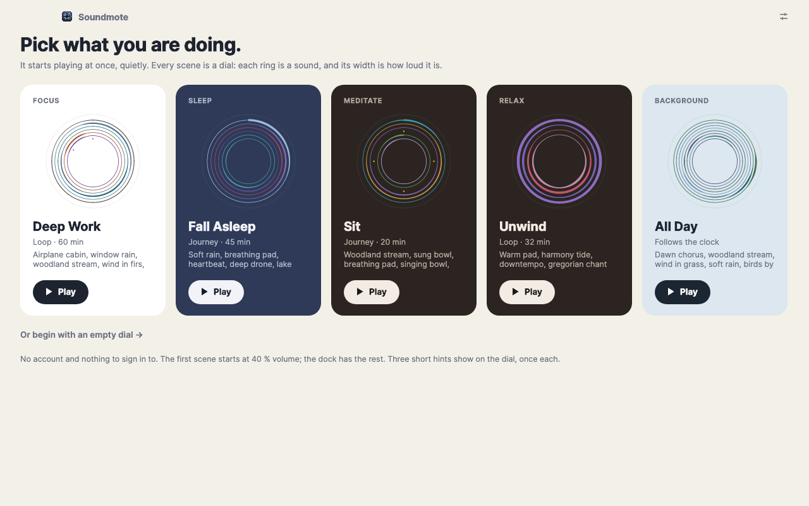
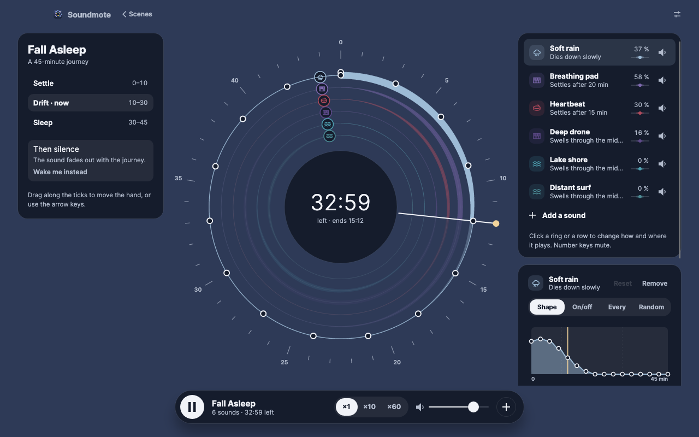
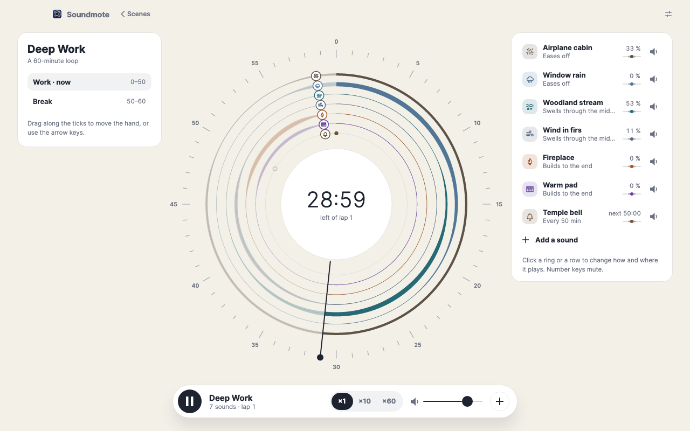
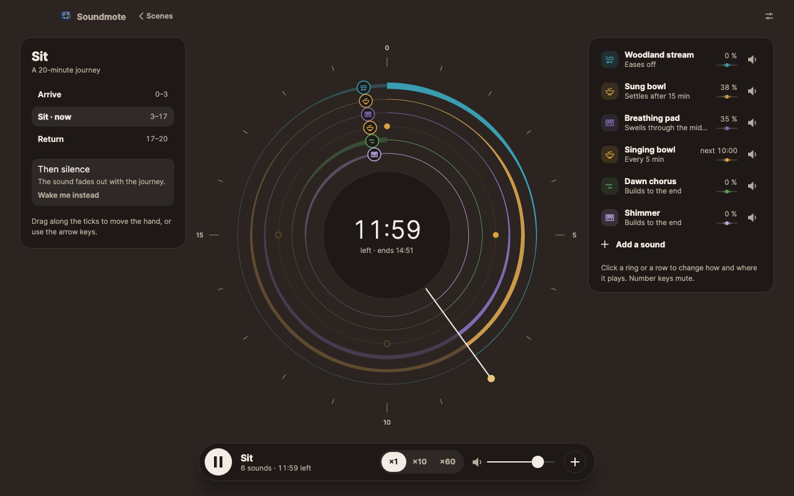
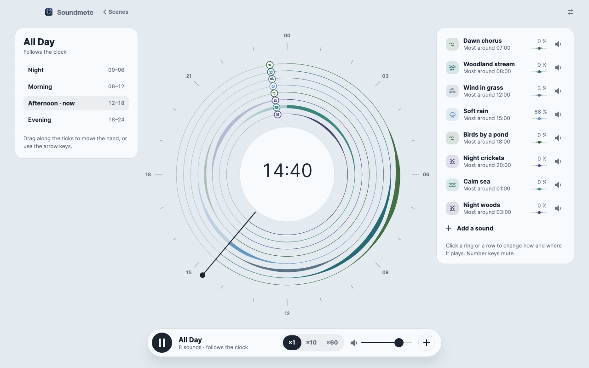
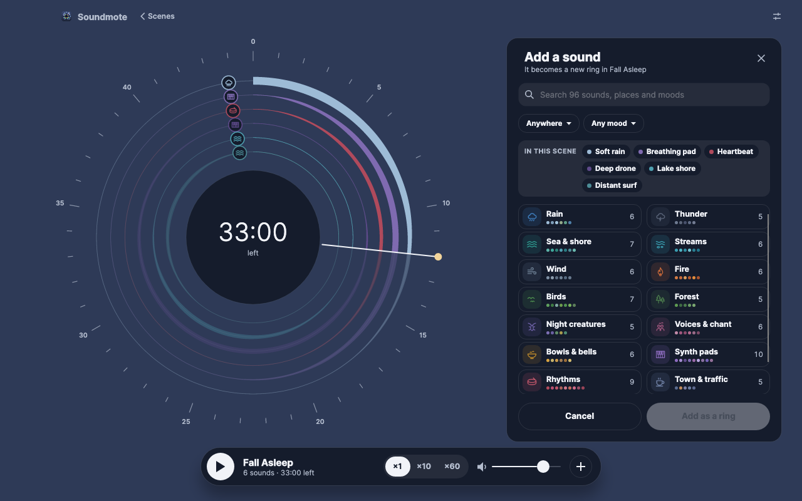

# Soundmote

[English](README.md) · **Dansk**

Lydlandskaber at sove, arbejde, meditere og slappe af til, til macOS, Windows og Linux. Hver scene er en skive: én
ring pr. lyd, og ringens bredde er, hvor kraftig lyden er lige der.

**Denne app er skrevet af en maskinintelligens.** Al kode, alle kommentarer, designet, de lavede lyde, app-ikonet,
testene, dokumentationen og denne README er lavet af Claude Opus 5.5 (Anthropic) efter beskrivelse fra et menneske.
Intet menneske har gennemgået koden linje for linje. Læs afsnittet [Ansvarsfraskrivelse](#ansvarsfraskrivelse), før du
stoler på den med noget, du holder af.



En scene er en rejse. Lydene skiftes: én stiger, mens en anden falder væk over nogle minutter, så du driver med og
glæder dig til det næste. Træk i viseren for at flytte dig i tiden, klik på en ring for at forme, hvordan den spiller,
og tilføj så mange lyde, du vil. Alt, du ændrer, gemmes med det samme. Der er ingen konto, ingen sky og intet netværk.

Bygget med .NET 10 og [Avalonia](https://avaloniaui.net) 12. Kun gratis komponenter med MIT eller lignende licenser; se
[Docs/dependencies.md](Docs/dependencies.md).

## Hvad den kan

- **Fem scener at starte fra.** Deep Work (et 60-minutters loop med en pause ved bålet), Fall Asleep (en 45-minutters
  rejse ind i søvnen), Sit (en 20-minutters siddning), Unwind (et 32-minutters loop) og All Day (følger uret, fra fugle
  ved daggry til havet om natten).
- **Tre slags tid.** En rejse har en ende og kan vække dig med en morgen på et tidspunkt, du vælger. Et loop spiller
  rundt og rundt. En urscene følger tiden på dagen.
- **96 lyde i femten familier.** Regn, torden, hav og kyst, vandløb, vind, ild, fugle, skov, natdyr, stemmer og
  sang, skåle og klokker, synth-pads, rytmer, by og trafik, støj og puls. Et sted (skov, kyst, indendørs …) og en
  stemning (rolig, hyggelig, mystisk …) snævrer listen ind.
- **Form hver ring.** Tegn dens kurve, eller lad den tænde og slukke, slå an med få minutters mellemrum eller slå an
  tilfældigt. Placér den mellem venstre og højre, og lad den vandre, krydse eller springe.
- **Waver.** En pads tonehøjde kan flyde og flimre, op til en halv tone, og blive i tonearten.
- **Ét tempo pr. scene.** Rytmerne er rolige pulser, der bærer pads'ene: et hjerteslag, en blød puls, rammetrommer,
  håndtrommer, en kalimba, en baspuls og flere. Sæt scenens tempo, 40 til 120 slag i minuttet, og alle rytmer følger.
- **Nye scener** fra en tom skive eller fra en anden scenes lyde, og Duplikér, Omdøb og Nulstil til resten.



## Tastaturet

| Tast | Gør |
| --- | --- |
| `mellemrum` | Afspil / pause, på skiven og i biblioteket |
| `←` / `→` | Flyt viseren et minut tilbage / frem |
| `1` – `9` | Slå den ring fra eller til |
| `esc` | Luk tilføj-panelet (eller gå tilbage fra en familie), fravælg ringen, derefter tilbage til biblioteket |
| `⌘N` | Ny scene (`Ctrl` på Windows og Linux) |
| `⌘D` | Duplikér den åbne scene |
| `⌘,` | Indstillinger; `esc` går tilbage |

De enkelte taster gør intet, mens du skriver i et felt.

## Skærmbilleder

| | |
| --- | --- |
|  |  |
| Fall Asleep: blød regn går over i en pad, der ånder, og et langsomt hjerteslag | Deep Work: regn på ruden går over i en bæk og så i vind |
|  |  |
| Sit: en syngende skål gennem den stille midte og et anslag hvert femte minut | All Day: én lyd ad gangen gennem døgnet |
|  | |
| Tilføj en lyd: femten familier, snævret ind efter sted og stemning | |

Alle skærmbilleder er tegnet af appen selv, uden skærm, af testene i `tests/Soundmote.Desktop.Tests`.

## Lydene

- **Optagelser** til alt levende: regn, hav, vandløb, vind, ild, fugle, skove, natdyr, stemmer, skåle og klokker,
  byer. Hver er CC0 (fri for ophavsret), kun én ting (regn er kun regn) og skåret, så den kører i ring uden samling og
  blander sig med resten.
- **Lavede lyde** til pads og rytmer, som den slags lyde altid er. Hver pad og hvert stemt anslag bruger kun tonerne
  D E F G A C, så to vilkårlige klinger godt sammen.
- **Én lydstyrke.** Hver lyd er justeret til samme niveau ved fuld styrke, så en rings bredde betyder det samme for
  dem alle.

Hvordan hver lyd er valgt, skåret eller lavet, står i [Docs/sound-design.md](Docs/sound-design.md).

## Byg og kør

Kræver [.NET 10 SDK](https://dotnet.microsoft.com/download).

```bash
dotnet build Soundmote.slnx
```

```bash
dotnet run --project src/Soundmote.Desktop
```

Kør testene:

```bash
dotnet test Soundmote.slnx
```

Testene starter den rigtige app uden skærm (Avalonias headless-platform) og tegner den med Skia, og de afspiller hver
lyd for at tjekke dens lydstyrke, og at intet på lydtråden allokerer.

**Lyd live findes indtil videre kun på macOS.** På Windows og Linux åbner appen og virker, men spiller endnu ikke
noget (se [Docs/todo.md](Docs/todo.md), N1).

Sandkassen i `tools/Soundmote.Sandbox` spiller motoren uden appen og forbereder lyde:

```bash
dotnet run --project tools/Soundmote.Sandbox -c Release -- levels
```

### Hvor dine data ligger

Dine scener er JSON-filer i en `Scenes`-mappe, med indstillingerne i `settings.json` ved siden af:

| System | Mappe |
| --- | --- |
| macOS | `~/Library/Application Support/Soundmote/` |
| Windows | `%APPDATA%\Soundmote\` |
| Linux | `$XDG_DATA_HOME/soundmote/` (ellers `~/.local/share/soundmote/`) |

## Hvad appen henter fra nettet

Intet. Alle lyde følger med appen, og intet sendes nogen steder hen. Der er ingen statistik, ingen sporing og ingen
konto.

## Dokumentation

Projektet er beskrevet i `Docs/`, med et id på hver regel, så kode og dokumenter kan pege på hinanden:

| Fil | Indhold |
| --- | --- |
| [Docs/architecture.md](Docs/architecture.md) | Hvordan motoren og appen er sat sammen: projekter, scener, lydtråden, takten |
| [Docs/design-language.md](Docs/design-language.md) | Designet: tokens, baggrunde, skiven, docken, ord, taster |
| [Docs/sound-design.md](Docs/sound-design.md) | Hvordan hver lyd er optaget eller lavet, og lydstyrkebalancen mellem dem |
| [Docs/pitfalls.md](Docs/pitfalls.md) | Fejl, der ikke siger noget, med rettelsen og målingen, der beviser den |
| [Docs/todo.md](Docs/todo.md) | Hvad der mangler, og hvordan det tjekkes |
| [Docs/dependencies.md](Docs/dependencies.md) | Hver pakke og hver optagelse med sin licens |

## Ansvarsfraskrivelse

**Skrevet af en maskine.** Hele projektet er genereret af Claude Opus 5.5, en sprogmodel fra Anthropic. Koden
afprøves af omkring 525 automatiske tests, der kører appen uden skærm og afspiller hver lyd, men den er ikke gennemgået
linje for linje af et menneske. Lydene er valgt og lavet ud fra målinger. Et menneskeligt øre er den endelige dommer,
og den lytning er ikke færdig (se [Docs/todo.md](Docs/todo.md), N12).

**Pas på ørerne.** Start lavt. Appen begrænser sin egen udgang, men højttalere, hovedtelefoner og systemets lydstyrke
er dine at sætte.

**Ingen garanti.** Appen leveres, som den er, uden garanti af nogen art. Brug den på eget ansvar. Hverken
forfatteren, Anthropic eller andre er ansvarlige for noget, der måtte følge af brugen.

**Ikke signeret.** Der er ingen signerede eller notariserede pakker. Bygger du den selv, kan macOS og Windows advare,
første gang appen åbnes.

Appen er lavet til privat brug og er ikke tilknyttet nogen virksomhed eller noget produkt.

## Licens

[MIT](LICENSE). Du må bruge, ændre og videregive koden, også kommercielt, så længe copyright-linjen og licensteksten
følger med. De lavede lyde (pads'ene og rytmernes anslag) hører til projektet og er under samme licens. Optagelserne er
CC0 (fri for ophavsret), og pakkerne og skriften har deres egne licenser (MIT, Apache 2.0 og OFL); se
[Docs/dependencies.md](Docs/dependencies.md).
