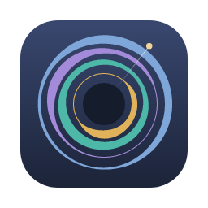
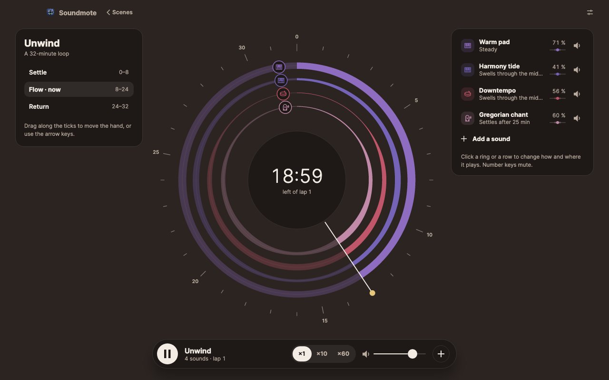
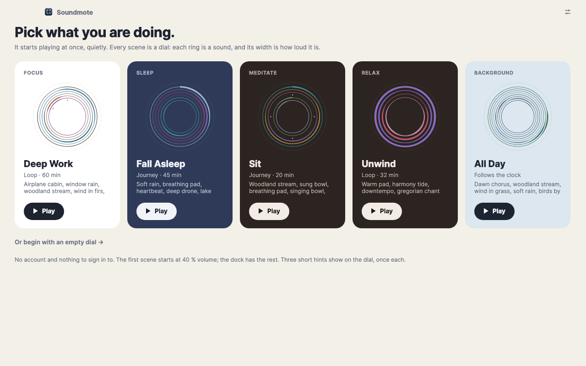
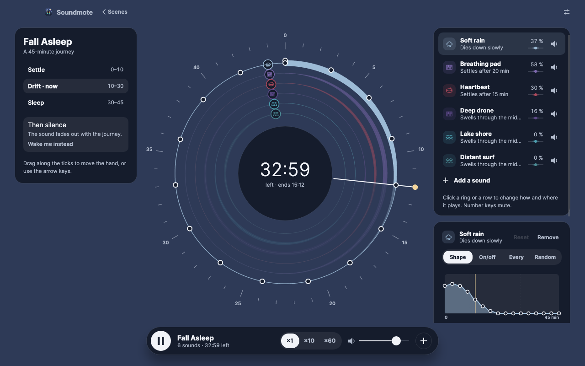
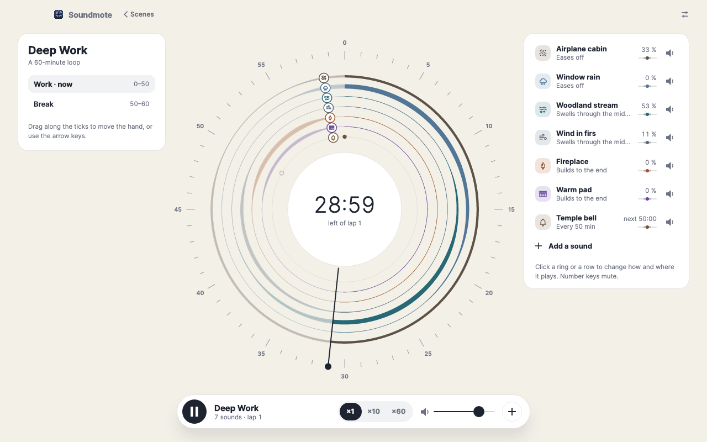
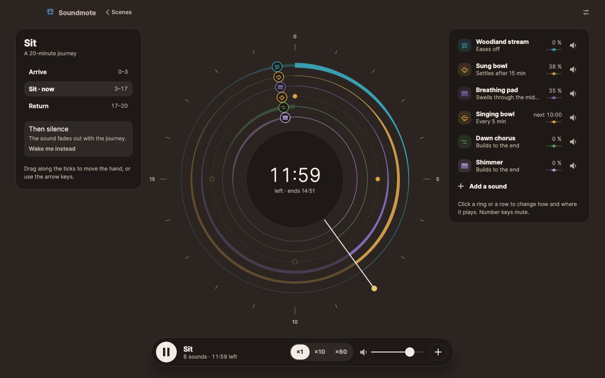
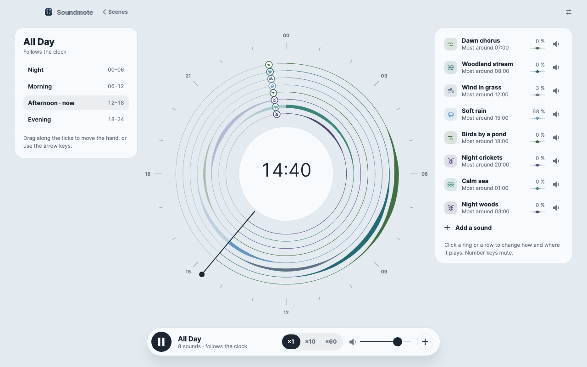
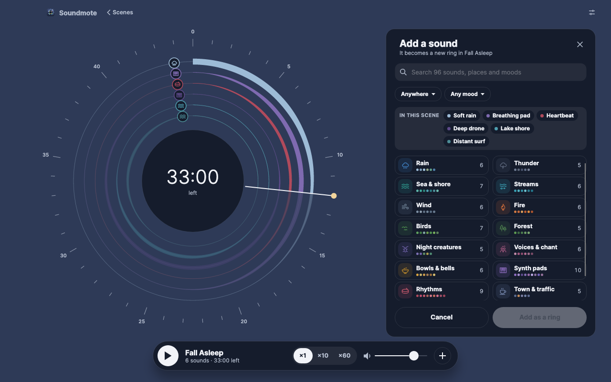

# Soundmote

**English** · [Dansk](README.da.md)

Ambient soundscapes to sleep, work, meditate and relax to, for macOS, Windows and Linux. Each scene is a dial: one
ring per sound, and the ring's width is how loud it is at that moment.

**This app was written by a machine intelligence.** All the code, the comments, the design, the made sounds, the app
icon, the tests, the documentation and this README were made by Claude Opus 5.5 (Anthropic) from a human's
description. No human has reviewed the code line by line. Read the [Disclaimer](#disclaimer) before you trust it with
anything you care about.



A scene is a journey. Sounds take turns: one rises as another falls away over minutes, so you drift along and look
forward to what comes next. Drag the hand to move in time, click a ring to shape how it plays, and add as many sounds
as you like. Everything you change is kept at once; there is no account, no cloud and no network.

Built with .NET 10 and [Avalonia](https://avaloniaui.net) 12. Only free components with MIT or similar licences; see
[Docs/dependencies.md](Docs/dependencies.md).

## What it does

- **Five scenes to start from.** Deep Work (a 60-minute loop with a break by the fire), Fall Asleep (a 45-minute
  journey into sleep), Sit (a 20-minute sitting), Unwind (a 32-minute loop) and All Day (follows the clock, from birds
  at dawn to the sea at night).
- **Three kinds of time.** A journey has an end and can wake you with a morning at a time you choose; a loop plays
  round and round; a clock scene follows the time of day.
- **96 sounds in fifteen families.** Rain, thunder, sea and shore, streams, wind, fire, birds, forest, night creatures,
  voices and chant, bowls and bells, synth pads, rhythms, town and traffic, noise and pulse. A place (forest, shore,
  indoors…) and a mood (calm, cosy, mysterious…) narrow the list.
- **Shape each ring.** Draw its curve, or let it play on and off, strike every few minutes, or strike at random. Place
  it between left and right, and let it wander, cross or flit.
- **Waver.** A pad's pitch can drift and flutter, up to half a semitone, and stay in key.
- **One tempo per scene.** Rhythms are calm pulses that carry the pads: a heartbeat, a soft pulse, frame drums, hand
  drums, a kalimba, a bass pulse and more. Set the scene's tempo, 40 to 120 beats a minute, and every rhythm follows.
- **New scenes** from an empty dial or from another scene's sounds, and Duplicate, Rename and Reset for the rest.
- **Export to a file.** Render a scene to M4A (AAC) or WAV, many times faster than it plays: a whole journey, a number
  of laps of a loop, or hours of a clock scene from the hour you pick. On Linux it is WAV only, as the system has no
  AAC encoder of its own.



## The keyboard

| Key | Does |
| --- | --- |
| `space` | Play / pause, on the dial and in the library |
| `←` / `→` | Move the hand a minute back / forward |
| `1` – `9` | Mute or unmute that ring |
| `esc` | Close the add panel (or go back from a family), deselect the ring, then back to the library |
| `⌘N` | New scene (`Ctrl` on Windows and Linux) |
| `⌘D` | Duplicate the open scene |
| `⌘E` | Export the open scene to a file; `esc` cancels |
| `⌘,` | Settings; `esc` goes back |

The single keys do nothing while you type in a field.

## Screenshots

| | |
| --- | --- |
|  |  |
| Fall Asleep: soft rain hands over to a breathing pad and a slow heartbeat | Deep Work: rain on a window gives way to a stream, then wind |
|  |  |
| Sit: a sung bowl through the quiet middle, a bowl struck every five minutes | All Day: one sound at a time through the day |
|  | |
| Add a sound: fifteen families, narrowed by place and mood | |

Every screenshot is drawn by the app itself, without a screen, by the tests in `tests/Soundmote.Desktop.Tests`.

## The sounds

- **Recordings** for everything that lives: rain, sea, streams, wind, fire, birds, forests, night creatures, voices,
  bowls and bells, towns. Each is CC0 (public domain), one thing only (rain is only rain), and cut so that it loops
  without a seam and mixes with the rest.
- **Made sounds** for pads and rhythms, as such sounds always are. Every pad and every tuned hit uses only the notes
  D E F G A C, so any two sound well together.
- **One loudness.** Every sound is trimmed to the same level at full, so a ring's width means the same for all of them.

How each sound is chosen, cut or made is in [Docs/sound-design.md](Docs/sound-design.md).

## Build and run

Requires the [.NET 10 SDK](https://dotnet.microsoft.com/download).

```bash
dotnet build Soundmote.slnx
```

```bash
dotnet run --project src/Soundmote.Desktop
```

Run the tests:

```bash
dotnet test Soundmote.slnx
```

The tests start the real app without a screen (Avalonia's headless platform) and draw it with Skia, and they render
every sound to check its loudness and that nothing on the audio thread allocates.

**Live sound is macOS only for now.** On Windows and Linux the app opens and works, but plays nothing yet (see
[Docs/todo.md](Docs/todo.md), N1). Export works on all three.

The sandbox in `tools/Soundmote.Sandbox` plays the engine without the app and prepares sounds:

```bash
dotnet run --project tools/Soundmote.Sandbox -c Release -- levels
```

### Where your data lives

Your scenes are JSON files in a `Scenes` folder, with the preferences in `settings.json` beside it:

| System | Folder |
| --- | --- |
| macOS | `~/Library/Application Support/Soundmote/` |
| Windows | `%APPDATA%\Soundmote\` |
| Linux | `$XDG_DATA_HOME/soundmote/` (otherwise `~/.local/share/soundmote/`) |

## What the app fetches from the network

Nothing. Every sound ships with the app, and nothing is sent anywhere. There are no analytics, no tracking and no
account.

## Documentation

The project is described in `Docs/`, with an id on every rule, so code and documents can point to each other:

| File | Contents |
| --- | --- |
| [Docs/architecture.md](Docs/architecture.md) | How the engine and app are put together: projects, scenes, the audio thread, the beat |
| [Docs/design-language.md](Docs/design-language.md) | The design: tokens, grounds, the dial, the dock, words, keys |
| [Docs/sound-design.md](Docs/sound-design.md) | How each sound is recorded or made, and the loudness balance between them |
| [Docs/pitfalls.md](Docs/pitfalls.md) | Failures that say nothing, with the fix and the measurement that proves it |
| [Docs/todo.md](Docs/todo.md) | What is missing, and how to check it |
| [Docs/dependencies.md](Docs/dependencies.md) | Every package and every recording with its licence |

## Disclaimer

**Written by a machine.** The whole project was generated by Claude Opus 5.5, a language model from Anthropic. The
code is exercised by about 525 automated tests that run the app without a screen and render every sound, but it has
not been reviewed line by line by a human. The sounds were chosen and made by measurement; a human ear is the final
judge, and that listening is not finished (see [Docs/todo.md](Docs/todo.md), N12).

**Mind your ears.** Start quietly. The app limits its own output, but your speakers, headphones and system volume are
yours to set.

**No warranty.** The app is provided as is, without warranty of any kind. Use it at your own risk. Neither the author,
Anthropic nor anyone else is liable for anything that may follow from using it.

**Not signed.** There are no signed or notarised packages. If you build it yourself, macOS and Windows may warn the
first time the app is opened.

The app is made for private use and is not affiliated with any company or product.

## Licence

[MIT](LICENSE). You may use, change and pass on the code, commercially too, as long as the copyright line and the
licence text go with it. The made sounds (the pads and the rhythms' hits) are part of the project and come under the
same licence. The recordings are CC0 (public domain), and the packages and the typeface have their own licences (MIT,
Apache 2.0 and OFL); see [Docs/dependencies.md](Docs/dependencies.md).
